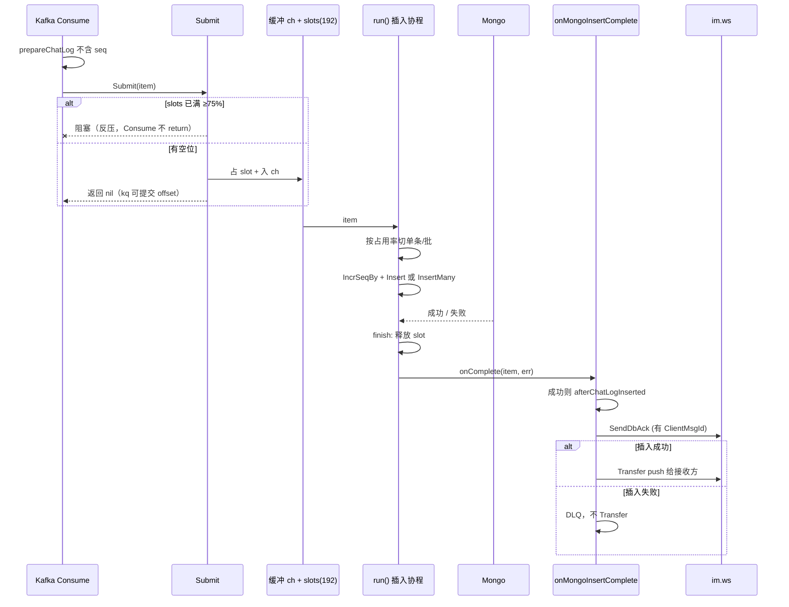
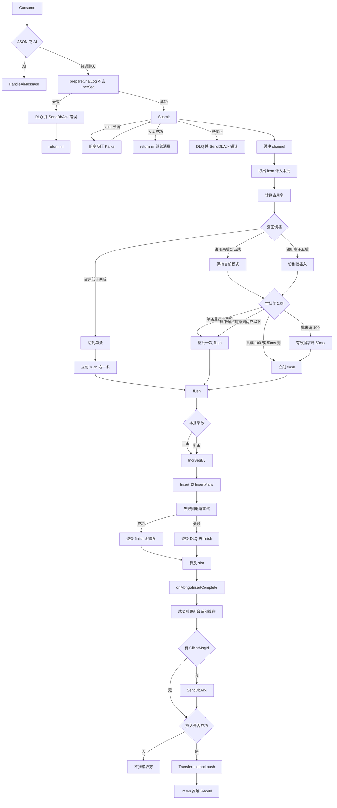

[TOC]

# 讲一下整体链路

1.客户端发消息，先找到conn，如果是第一次上线发消息，建立conn启动keepalive监听这个conn，然后先通过redis判断用户之前在哪个实例，然后再更新用户现在的实例，然后根据之前的实例，通过RPC调用，远程踢掉之前的conn。

（补充）建连发生在 HTTP Upgrade 之后：`NewConn` 里 `upgrader.Upgrade`，立刻 `go conn.keepalive()`，并 `NewConnQueue` 启动这条连接的 Actor 写协程。本机身份在 `addConn`：把 uid→conn 放进 `userToConn`。若 map 里已经有旧 conn 且不是当前这条，**本机直接 `Close(old)`**，这是同实例顶号。

（补充·Redis）位置 key 是 `ws:user:instance:{userId}`，`SetUserInstance` 用 `SETEX`。默认 TTL **24 小时**，不是没有过期时间；断线/主动下线应 `DelUserInstance`，在线期间可用 `KeepAlive` 续 TTL（只是建议没用实现）。

（补充·跨实例踢人）gRPC 服务端 `NotifyOffline`：对端 `GetConn` 后 `Close`。客户端封装是 `WsRelayer.NotifyUserOffline`：先 Redis 查实例，本机就关，远程就 RPC。**更正：上线主路径 `addConn` 目前只 Set 新实例地址 + 关本机旧 conn，没有先 Get 旧地址再调 `NotifyUserOffline`。** 所以「先判断之前在哪个实例再 RPC 踢」是已写好的能力，还没接到第一次上线。旧实例上的 conn 可能短暂仍在，直到空闲超时或对端自己断开。面试可以说：同机必踢；跨机接口有、接线待补，否则会双连接、推送打到 Redis 上记录的新实例，旧连接收不到也占着。

（补充）keepalive 不是业务层「定时 Ping 包」那一种实现：它是 **空闲计时器**。`idle` 为零值表示连接正在活跃（写路径会把 idle 置零），到期只重置满周期；`idle` 为时间戳表示已经空闲，用 `maxConnectionIdle - since(idle)` 判断是否该 `Close`。另有 `FramePing` 在 `handlerWrite` 里回包，给客户端心跳走。NAT/负载均衡更依赖 Ping；服务端这套防止死连接占着 map 和 Redis 位置。

（补充·下线删位置）`Server.Close` 里若该 uid 已经没有 conn，会 `DelUserInstance`。顶号只关旧连接、新连接还在，不会删 Redis。连接上的 `keepalive()` **不续** 位置 TTL；`KeepAlive()`（再 SETEX）工程里没有调用点。

2.建立完conn后或者是之前有conn，从本地map中拿出conn，先判断ack模式，如果是noack，客户端直接返回，消息直接发给conn.message（1缓冲管道）然后下游handlerWriter处理数据，调用ws.push，发送到ws服务端，ws服务端拼装消息，发送给kafka。如果是onlyack或者严格ack，会先放入readMessage（ack处理队列中），onlyack本地写入到分片map中就可用返回了，严格ack还要等待mongo落库成功。readMessage采用sync.Cond等待切片不为0的条件。

（补充）三种模式在 `AckType`：`NoAck / OnlyAck / RigorAck`。`isAck`：非 NoAck 且帧不是 `FrameNoAck` 才走 ACK 队列。`readAck` 协程：`messageMu` + `readAckCond`，`len(readMessage)==0` 就 `Wait`，有数据再取下标 0。

- NoAck：进 `conn.message`（chan 容量 1），`handlerWrite` 按 `message.Method` 找 route，聊天 handler 里拼 `MsgChatTransfer`，`mqclient.Push` 进 Kafka。发送方不等服务端 ACK。
- OnlyAck：`readAck` 先组 `FrameAck`（`AckSeq+1`），`Send` 给本 conn，再把原消息丢进 `message`。发送方 p99 卡的是 **进队+回 ACK**，不是 Kafka、不是 Mongo。你简历里的 p99<65ms 对应这条。
- RigorAck：`readAck` **先把消息交给业务**（同样进 `message` 去 Push Kafka），**不在这里回 ACK**。设计上要等 task 落库 `SendDbAck` → ws `handleDbAck` 再给客户端 AckSeq=1；客户端再回 AckSeq≥2，`handleClientAck` 从分片 map 删掉。`StoreToShardedAckMap` 按 msgId 的 FNV 分 32 片，避免一把大锁。

（更正）「onlyack 本地写入到分片 map 就可以返回」——分片 map（`shardedAckMap`）注释写的是 **RigorAck 三次握手** 存待确认消息；OnlyAck 是 `readAck` 里直接 `Send` ACK，不必等 map。OnlyAck 的「可返回」是 ACK 帧写进该 conn 的发送路径。

（更正）**现网 `apps/im/ws/im.go` 是 `WithServerAck(OnlyAck)`。** 严格 ACK 的 `handleDbAck` 开头 `if s.opt.ack != RigorAck { return }`，所以即使 task 发了 DbAck，生产配置下也不会走三次握手。面试要说：代码三种都在，默认/现网 OnlyAck；严格模式要改 ServerAck 并保证客户端按 AckSeq 回第三下。

3.Kafka消费端是使用的gozero封装的kq组件，多协程消费同一分区，且保证分区消费有序，Kafka消费者的consume函数先保存消息到mongodb，并生成递增序列号。如果成功通过ws.SendFrameDbAck通知严格ack落库成功，和客户端进行最后ack确认，客户端收到后要回复ack，两端状态严格一致。如果一直失败投递到DLQ。

（更正·Consume 做什么）`MsgChatTransfer.Consume`：JSON 反序列化 →（AI 则 `HandleAiMessage`）→ `prepareChatLog`（**此时 Seq 未发**，`NewObjectID` 当 `_id`）→ `batchProcessor.Submit` → **`return nil`**。kq 把 nil 当消费成功去 **提交 offset**。seq 在插入协程 `assignSeqAndInsert` 里 `IncrSeqBy` 才生成。

（更正·kq 并发与顺序）`etc/dev/task.yaml` 里 `MsgChatTransfer.Consumers: 1`，现网 **不是** 多协程打同一分区。kq 把 `Consumers` 调大时，多个 handler 并发 `Consume`，**同一分区也不保证回调顺序**。会话有序不能靠「kq 保证分区有序」这句话，要靠 **生产端 partition key=conversationId**（现码 `Push` 只有 value、**没有 key**）+ 单线程处理该分区 + 落库 seq。

（补充·DLQ）Submit 失败（处理器停了等）会 `sendToDLQ` 并尽量 `SendDbAck` 错误，Consume 仍 `return nil` 避免死循环占分区。插入阶段 `retry` 1s/2s/4s 仍失败则逐条 DLQ，topic `msgChatTransferDLT`，要在 Kafka 里先建好。

（补充·严格 ACK 通知）插入回调 `onMongoInsertComplete`：有 `ClientMsgId` 时 **成功失败都** `sendDbAck`；成功才 `afterChatLogInserted`（设置缓存相关） + `Transfer`。DbAck 到 im.ws 后，只有 RigorAck 才 `handleDbAck` 给发送方 ACK，客户端再回第三下，服务端删分片 map，「两端状态严格一致」指的是这一轮，**不是 OnlyAck**。

4.落库成功，Kafka消费者通过ws.Send发送到ws服务端，服务端快速处理，将数据缓存到workpool中（为了防止Kafka消费者直接发给ws服务端阻塞导致消息堆积），后续提供worker慢慢消费这里缓存的数据，为了防止并发数太多，通过工作令牌的方式限制并发数（如果有任务且有多余令牌启动一个worker，工作完归还令牌）。worker将数据写入conn的connQueue（管道）中（actor模式中，conn是actor，connQueue是信箱）

（补充）task 侧 `Transfer` 组 `ws.Push`（含落库后的 Seq、MsgId、RecvId/RecvIds）。im.ws 入口不要在 gRPC/Kafka 回调里直接 `conn.WriteMessage`：gorilla websocket **写不并发安全**，且慢客户端会把消费线程堵住，Kafka lag 和插入回调（同一插入协程里同步 Transfer）会一起恶化。

（补充·WorkerPool，现码）原文「有任务且有多余令牌启动 worker，工作完归还令牌」仍然对 **execute 这一段**：令牌 `workPass` 容量=`poolSize`，拿到 task 之后阻塞 `workPass <- {}`，`execute` 完 `<-workPass` 归还。空闲等队列的人 **不占令牌**。

（更正·不要说成队列空就退 / select+default）现码 **不是**「取 task 执行完若队列空就退出还令牌」，也 **不是** 退出时 `select+default` 再抢令牌。

- **常驻 core：** `coreSize = poolSize/10+1`（默认 poolSize=100 → 11 个）启动时就 `go worker(true)`，一直 `task, ok := <-taskCh`，不因空闲退出，保证下一波推送不用等创建协程。
- **补 extra：** `Submit` 入队成功后，若 **`len(taskCh)>0`**（队列还积压，说明常驻的人正在忙）才 `trySpawnWorker`。`workerCount < poolSize` 时 CAS +1，再 `go worker(false)`。CAS 已经加过计数，`worker()` **不再 Add(1)**（旧实现会 +2，上限会漂）。
- **extra 退出：** `select { case task:=<-taskCh; case <-timer.C }`，空闲 `extraIdle`（第三个参数现为 **毫秒**，Server `poolThreshold=1000` → **1s**）没有任务就 `return`，`defer workerCount-1`。**第一次收任务也带超时**，避免抢不到活却永远堵在 `<-taskCh` 上变成幽灵常驻。
- **不用 `default`：** IM 推送一阵一阵，`select+default` 会在队列空的同一拍把 extra 退光，下一条冷启动。保底常驻 + extra 空等 1s，突发能扩到 poolSize，夜里只剩 core。
- **「跑满随机 N 次自杀」有半截道理，但现在用 extra 空等退出覆盖同一目的：**  
  runtime `gfput`：**只有栈仍是起始大小**（未扩容）的 `g` 会带着栈进 `gFree` 复用；**扩过容的栈在 g 退出时 `stackfree`**，不会把大栈留在 gFree 里。所以「活着不退出的 worker 一旦扩过栈，这块大栈就一直挂在这个 g 上」——这才是旧实现杀协程的原因，不是 GC 扫不出垃圾。  
  活着的 g 还可以靠 GC 的 `shrinkstack`（使用量 &lt; 1/4 才缩，且要安全点），**阻塞在 `taskCh` 上不等于立刻缩栈**。若你现在不指望 shrink、也确实看到 gFree 只留未扩容栈，那 **extra 空等 1s 退出** 仍然会走 `stackfree`，把扩过的栈还回去；**core 常驻** 仍可能顶着大栈，这是保延迟换内存。不必再「随机跑满 N 次就杀」，杀太勤还要不断 `go worker`。
- `Stop` 关 `taskCh`，用 `ok==false` 退出，避免关频道后空转。

（补充·跨实例）本机没有 conn：Relayer 查 Redis 实例，gRPC `SendToUser`（frameType/method/msgId/data JSON），对端再 `GetConn` → 同样走 Send → WorkerPool → 该 conn 的 Queue。**不把 *websocket.Conn 传到别的进程。**

5.conn在启动时，会启动一个actor，这个actor通过监听connQueue有没有数据，如果有数据会串行写入到这个conn中，因为每一个conn只有一个actor，天然串行没有并发冲突。

（补充）`ConnQueue` 默认缓冲 256。`Submit` 把已经序列化好的帧丢进 `ch`；单独 goroutine `WriteMessage`。满了带超时（默认 5s），当慢客户端，超时踢下线，避免一个手机把 worker 令牌和插入回调全部卡住。关闭 `closeOnce`，后续 Submit 立刻失败。这同时解决：多 worker 写同一 conn panic；慢客户端反压范围限制在 **这一条信箱**。WorkerPool 的 `execute` 只 `queue.Submit`，真正写 socket 仍是该 conn 的 Actor。

6.客户端收到消息，根据前端代码（展示或者去重等待或者重新发送补发请求）

（补充）接收方应用层建议：按 `conversationId+seq` 插入有序列表；`clientMsgId` 去重；seq 缺口触发补拉（从 lastSeq+1 到当前）；超时再展示「可能未送达」并通知发送方 UI。发送方 OnlyAck 只表示 **服务端入队**；要「对方一定看到」需要投递回执或已读，现码推失败没有服务端补偿。

---

# 严格模式插入成功怎么通知

Kafka消费后，投递到BatchProcessor中等待批插入或者单挑插入，消费者就返回了继续消费，有BatchProcessor决定何时插入，插入成功后，通过ws.Client返回到ws服务端，服务端根据userid找到对应conn或者跨实例relayer。发送给客户端，客户端收到返回ack。

（补充·时序）Consume 线程：`Submit` 占 slot（满 192 阻塞，Kafka 这侧不 return、offset 不往前）→ 入 `ch` → return nil。插入线程 `run()`：按占用滞回单条/批 → `persistConvGroup`（事务里 IncrSeqBy+Insert，不行就 plain）→ `finish` 放 slot → `onMongoInsertComplete`。回调里：`afterChatLogInserted`（UpdateMsg、缓存）→ `SendDbAck` → `Transfer`。**Transfer 仍在插入协程同步执行**，会挡住下一次 flush。

（补充）「发送给客户端」对发送方是 DbAck/严格 ACK；对接收方是 Push 内容。不要混成同一次包。RigorAck 发送方：AckSeq=1 后必须再回 AckSeq=2，否则分片 map 泄漏（只有握手完成才 delete）。

---

## 消息怎么有序

业务上「有序」拆成四段，不能只说 Kafka。

**1. 同一发送方、同一连接上行**  
单 conn 读循环是一条 goroutine 读 websocket，进入 `readMessage` / `message` 的顺序就是到达顺序。OnlyAck 的 `readAck` 也是单协程按切片顺序处理，不会把后到的消息先回 ACK 再乱序 Push（同一连接内）。

**2. 进 Kafka 之后**  
没有 conversationId 作 partition key 时，同会话两条可以进不同分区，**分区内有序 ≠ 会话内有序**。多消费者并发 Consume 更会打乱。现码 Consumers=1，减轻了「同分区乱序」，但 **跨分区仍乱**。落库时 `groupByConversation` 按本批入队顺序给连续 seq，**seq 反映的是这批被插入协程看到的顺序**，不一定是用户点发送的墙钟顺序。

**3. 会话内最终顺序（给已读游标、历史）**  
`conversation.seq` 上 Mongo `$inc` / `IncrSeqBy(n)`，同一会话文档行锁级串行，**不会两个相同 seq**。一批 n 条：`start=end-n+1` 填到每条 `chat_log.seq`。客户端和已读游标认这个号。`(conversationId, seq)` 现码是 **普通索引不是 UNIQUE**，若 `UpdateMsg` `$set seq` 把计数器写小，理论上能插出重复 seq，这是有序语义的洞。

**4. 下行到某一个接收方**  
WorkerPool 里多个 extra 可能并发 `execute`（受 `workPass` 限制），但进同一 `ConnQueue` 后 **单 Actor FIFO 写 socket**，该用户这条连接上的字节序就是入信箱序。跨实例则是「先到哪台的 Send 先后」，每台内部仍然 Actor 有序。群聊多个接收方之间 **不保证同时到达**，只保证每人自己连接上的顺序。

已读合并：窗口内多次 ReadMark 合成一次 Push，中间每一次已读事件的顺序被折叠，只保证合并后的 ReadRecords 集合。这是用顺序换 QPS。

若面试追问「如何会话内 Kafka 也有序」：Producer `Push(conversationId, bytes)`；该 topic 分区数和会话哈希；消费组内一分区一线程（kq Consumers 不要大于需要的并发模型，或自己按分区串行化）；seq 仍然保留当展示与补洞的权威顺序。

---

## 消息怎么不丢失

按跳传递，每一跳丢失形态不一样。

**客户端 → im.ws**  
TCP/WS 本身有重传；应用层 OnlyAck 表示 **服务端入了 readMessage 并回了 ACK**。若 ACK 发出后进程在 Push Kafka 前崩溃，客户端以为成功，服务端没有消息——这是 OnlyAck 的取舍。RigorAck 把「成功」绑到落库后再 ACK，发送方等得久（批插入 50ms、Mongo RTT），这就是严格模式换不丢。

**im.ws → Kafka**  
Push 失败应让 handler 失败/让客户端感知。成功则消息在 Kafka 副本里（取决于 topic ACK 配置，面试提 `acks=all` + ISR）。

**Kafka → 插入缓冲**  
`Submit` 先占 slot 再入 ch。slot 满（75%×256=192）**阻塞 Consume**，kq **还不提交这条的 offset**，消息留在 Kafka，这是反压，防进程内存队列打满后只能丢。未占到 slot、处理器已 stop：DLQ + return nil。

**缓冲 → Mongo**  
插入协程挂了、进程被杀：ch 里的消息 **不在 Kafka 了**（若 Consume 已 return nil）。这是现码和「事务表+位点」最大的差别。补偿是 **at-least-once 重放**：下一次从已提交 offset 之后拉，但这批已提交的缓冲内容不会回来，只能靠 **尚未提交的** 还在 Kafka。已 Submit 且已 commit 的，进程崩溃 = 缓冲丢失 + **不会重放这批**（offset 已过）。（更正你后面「没落库就没交位点」——**现码会交。**）

**Mongo**  
副本集 + `WithTransaction` 把 IncrSeqBy 和 Insert 绑在一起，失败整段回滚，号和行一起没。单机/不支持事务走 fallback：可能号加了行没有（空洞）。Insert 失败重试可能 **再 IncrSeqBy**，空洞更大。DLQ 保住原始 Kafka 记录，可人工重放。

**Mongo → 接收方**  
只成功才 Transfer。Push 失败只打日志，**没有** 本地任务表、没有再投。接收方未在线：本来就不推，上线拉历史——前提是 Mongo 里有。在线推失败：对方内存里没有，库里有，要靠下次进房/补拉。WorkerPool `Submit` 超时会丢这次推送任务（有 metrics），同样没有补偿。

**严格 ACK 发送方**  
落库失败也会 DbAck 错误，客户端不应当成功；落库成功才展示「已送达服务器」。客户端第三下丢失只影响服务端 map，不影响库。

---

## 消息重发怎么办

**发送方超时重发**  
应带同一 `clientMsgId`。服务端应对 `(conversationId, clientMsgId)` 唯一：已存在则返回旧 seq、旧 `_id`，不再 `$inc`、不再 Transfer 或 Transfer 但接收方去重。  
（现码：**没有这唯一索引**；每次 Consume 新 ObjectID；Kafka 重放 / 用户重点发送 = 第二条 chat_log、seq 再加。）单条 Insert 把 `duplicate key` 当成功，只对 **同一 `_id`** 有用。

**Kafka 至少一次**  
Consume 已 return nil 后又一次投递同一 value：会再 Submit、再发号、再插。幂等必须业务键，不能靠 Kafka offset。

**接收方重复 Push**  
同一 seq 或同一 msgId 客户端丢弃。群聊合并已读也可能重复推合并结果，UI 按最后一次覆盖已读数。

**OnlyAck 后下游失败**  
用户再发：若新 clientMsgId，是两条合法消息；产品要提示「可能重复」或强制同 id 重试。

**补拉**  
seq 不连续：从缺口拉 Mongo。空洞（发号了没插上）会永远缺号，客户端应允许跳号或显示「已删除/未同步」，不要死等。

---

## 突发情况怎么办

**发送突发（写路径）**  
插入缓冲占用 <20% 单插，避免 50ms 空等把严格 ACK/发送体验钉死；>50% 批插满 100 或 50ms；20%～50% 不切防抖；≥75% 堵住 Submit，积压回 Kafka。这是插入延迟 vs 吞吐。Kafka 分区堆积用加分区/加消费者，但加消费者要牺牲会话顺序，需要先上 partition key。

**推送突发（读路径/扇出）**  
WorkerPool：`workPass` 限制同时 `execute` 数；core 常驻；队列积压才扩 extra，最多 `poolSize`；extra 空等 1s 退，避免夜里挂满协程。每 conn 有界信箱，慢的被踢，快的不受一个差网络拖死。群消息扇出：本机 conn 直接 Send，跨实例按实例聚合 userId 列表再 RPC（Relayer 里 remoteUsers map），减少每个 uid 一次拨号。

**已读突发**  
大群每个已读都扇出是 O(人数²) 量级的推送。人数超过 `GroupMsgReadAutoMergeThreshold`（dev 里是 **10**，不是 15）走合并窗口：满 `DelayCount` 或时间窗，不足一半再等 1s 并把窗口做大。人数掉下去 **不回退**，避免临界抖。

**热点群又发又进房**  
旁路「有新消息就删池」会导致进房打 Mongo。热点用 `hotLeaseAt` 双写追加 list + 热 hash，逻辑过期挡 TTL 击穿，单飞挡同进程同时重建。

**连接突发（上线）**  
大量重连：本机顶号、Redis 位置覆盖、keepalive 收死连接。跨机双连接问题在突发重连时更明显。

**Mongo/Redis 抖动**  
插入重试+DLQ；缓存失败降级旁路删 key，不挡落库。不要为 Redis 失败回滚 Mongo。

---

## 异常有没有补偿

| 场景 | 你原文/设计 | 现码 | 可补 |
| --- | --- | --- | --- |
| 插入多次失败 | DLQ | 有 | DLQ 消费者重放时走唯一键 |
| 缓冲进程崩溃 | 位点未交则重放 | **位点可能已交** | Submit 改同步等插入，或 outbox，或唯一键+可接受重复 |
| 双写 Redis 失败 | 删缓存重建 | 有设计 | 保持 |
| 推送失败 | 原文写了任务表/seq 补拉 | **未做** | 本地表定期 Transfer；客户端缺口补拉 |
| WorkerPool Submit 超时 | — | 丢任务打点 | 同上任务表 |
| 跨实例未踢 | RPC 踢 | 接口有、上线未调 | addConn 先 NotifyUserOffline 再 Set |
| seq 空洞 | 事务 | fallback/重试会洞 | 失败不要再 $inc；唯一 (conv,seq) |
| UpdateMsg 写小 seq | — | `$set seq` | `$max` 或只 $inc total |
| 严格 ACK map 泄漏 | 第三次 ACK 删除 | 要 RigorAck+客户端配合 | 超时扫分片 map |
| 消费毒消息 | return err 会卡分区 | JSON 失败 return err | 毒消息 DLQ 后 return nil |

补偿原则：Mongo 是事实源；Redis 可丢；Kafka 是运输；客户端 seq 是用户可感知的最后兜底。

---

# 缓存

## 1.用户登录

用户登录判断有没有之前的实例地址，没有过期时间。如果有之前的实例地址，说明用户是重新登录了，之前的conn还在。

在redis中写入自己的实例地址，用户退出时，删除。

（补充）key `ws:user:instance:{uid}`，值是本机 `localInstanceAddr`（ws 监听/relayer 地址）。读：推送和踢人都靠它。写：上线 Setex；下线 Del；心跳/活跃可 KeepAlive 续期。

（更正）**有过期时间，默认 24h。** 「没有过期时间」不成立。TTL 到期后 Redis 认为不在线，推送当离线，但进程里 conn 可能还在——所以 keepalive 关连接和 Del 要成对，否则幽灵连接。`Close` 且该 uid 无剩余 conn 时现码会 Del；`KeepAlive` 续 TTL **未接线**。

（补充）「有之前的实例地址 ⇒ 旧 conn 还在」只是大概率：TTL 还在、旧进程没挂。同机 old conn 在 addConn 必关。跨机必须 RPC 关，否则 Redis 已指向新实例，旧 conn 还占着旧进程内存，收不到新推送。

## 2.会话缓存

会话缓存主要是4部分，用户热点数据（hash），会话消息池（list），会话热数据（hash），会话冷数据（分片hash->string）。

用户热数据存储用户游标，用户水位线。（用户游标如果缓存有就用缓存的，如果缓存没有就用数据库的，水位线不持久化）

会话消息池存储近50条数据，每一个用户根据游标和水位线拼接自己的视野。

会话热数据，存储lastMsg，lastMsgCount（最后一条消息已读数），lastMesUpdatetime（不存储群游标，因为这是重要数据，缓存不可信，应该每一个用户上线在数据库查询。

会话冷数据，是通过json的方式存储的，一般是群名，群列表等不经常变得。

（补充）用户侧 `conv:state:{convId}:{userId}` 一类 hash：readSeq、unread、isShow、cacheSeq（水位）。进房 `EnsureReadSeq`：state 没有则 `readSeqStore.Load`（Mongo）再 `AdvanceReadSeq`。退房 `FlushCursor` 把热游标刷回存储。水位 `cacheSeq` 表示消息池已经覆盖到哪，只为拼视野，挂了就重新按池重建，所以不持久化。

（补充）消息池 list 存近 50 条结构化消息（seq、内容、发送者等）。用户视野：从自己的 readSeq/水位切一段，不是每人一份 list，所以能复用「一群一份池」。

（补充）`conv:hot:{convId}`：lastMsg 预览、lastMsgId、lastMsgReadCount、lastMsgUpdate、hotLeaseAt。已读回执 `MarkLastMsgReadAtomic` 用 userid+msgid 防重复计数。群的 maxSeq/总游标以 Mongo `conversation.seq` 为准，上线拉库，防缓存乱序导致未读算错。

（补充）冷数据 `conv:meta:{0-31}`，field=conversationId，value=JSON（chatType、memberCount、members）。读多写少：列表、鉴权、推群成员；写是拉人退群。

### 为什么热数据用hash存储

因为hash存储修改一个field不会影响其它field。如果是一个大string，每一次修改都要这个JSON修改，先不说字符串整体替换，就是JSON得频繁序列化和反序列化就接受不了。

（补充）已读数、lastMsg、lease 更新频率不同。Hash hashtable 编码后 HSET/HGET 单 field O(1)。整 JSON STRING：每次改已读数都 GET-改-SET 全量，CPU 和带宽都差，还容易丢并发更新（后写覆盖 lastMsg）。热字段短 TTL、按会话生命周期；和冷桶策略分开就是这个原因。

### 为什么消息池用list存

当前为了保证消息得有序性有两种方式，一种是zset一种是list，以我目前得场景来说，list完全可用保证有序（业务保证）。并且相较于zset得hash+skiplist，list得quicklist更节省内存。

但是消息池是旁路缓存，意味着每一次都是全量删除全量插入，如果在消息发送激烈得会话中可能会导致会话缓存频繁失效。但是只要用户不是发一条消息再进一次，就不会导致频繁失效，因为有信息删缓存，但是等用户进房才拉数据填缓存，这个缓存主要是为了优化，没有新消息时用户进群得速度的，一个用户进群拉取的缓存后续用户可用复用。

（补充）list 右侧 RPUSH 追加，下标/LRANGE 按插入序，对应「落库 seq 已定后再写池」时顺序与 seq 一致。zset 用 seq 当 score 能插历史洞，代价是 skiplist+dict。旁路删：`InvalidateOnNewMessage` 非热点 Del 池和 hot。热点 `dualWriteHotWithRetry`：原子更新 lastMsg + Append list，失败则 Del 降级。进房 miss 才 Load 近 50 填池，singleflight 防击穿。所以「发一条进一次」才是最坏：每条都删、每次进都打 Mongo；纯在房刷屏走 WS 推送，不一定打池。

### 为什么用户游标可用缓存

因为用户游标不是重要数据，每一次用户进房在mongo读取，在缓存中计算，退房再更新完全足够。如果要保证用户游标可靠，就要定时轮询刷盘，或者每一个游标更新都要刷盘，但是用户游标是最热的数据，假如400人的大群，且人全部在线，群游标更新一次，用户游标更新400次，一次数据光在这里就是401次的冲击。不划算。

（补充）群 maxSeq 一次 `$inc`（或 UpdateMsg）是会话级 1 次；若每个已读都落 Mongo 用户游标，在线 400 人就是 400 次写。现码已读走 Redis state + 热 hash 已读数，Mongo 游标进房/退房对齐。崩溃可能丢一段内存游标，进房以库为准，未读可能短暂不准，产品可接受。重要的是 **消息体和 seq 在 Mongo**，游标是可重建的投影。

---

## 会话缓存冷热分离

「热」指 **经常变的字段**（冷会话也有 seq/lastMsg），不是「热点会话」。热点另有 `hotLeaseAt` 和 15 分钟 TTL。

- **热字段** `conv:hot:{convId}`：每个会话一个 Hash。改 seq、lastMsg 只 HSET 对应 field，TTL 短、一会话一生命周期。顶层 key 多，**内存换灵活**。

- **静态元信息** `conv:meta:{bucket}`：`chatType` / `memberCount` / `members`。**读多写少**（列表、推群、鉴权常读，只有拉人退群才写），不是「很少访问」。32 个桶 `conv:meta:0..31`，field=`conversationId`，value=一小段 JSON。TTL 约 1h（带抖动），挂在 **桶 key** 上：到期整桶删；对该桶任意 `HSET` 会 **整桶 EXPIRE 重算 1h**；`Get` 不续期。主动删会话才 `HDEL` 单个 field。

  不用 100 万 STRING / 一会话一 Hash：那样是 100 万 dictEntry + key SDS + robj，过期键也 100 万。收到 32 个 Hash，100 万会话约每桶 3 万 field，顶层 32 个 key，省的是 **键空间元数据**。丢了 Mongo 回填，允许过期粒度是桶。热字段不能这么存：要按会话 TTL、按 field 更新。

### 大 key 与读压力

分 32 桶不是消灭大 key，是把「一个巨型 Hash」摊开。缓解大key。

- **点查可以：** 每桶 3 万 field 会走 hashtable 编码，`HGET` 某一个 convId 是 O(1)，**不会读整桶**。单机 Redis 命令本身串行，32 个 key 和 100 万 key 的 HGET 复杂度一样。

- **真正抖的是整 key：** `HGETALL`、`DEL`、TTL 到期删整桶，要处理大量 field。约定只 HGET/HSET 单 field。

  TTL是1h，不会频繁删除。

- **单个 field 过大：** 群 `members` 上万时，每次 HGET 都拷一份大 JSON，这才是读路径上的大 key，和 field 个数无关，名单应拆出去。

（补充）Cluster 下 32 个桶 key 可能落在少数 slot，形成 **slot 热点**；再打散桶数或加 hash tag 策略时要单独说。热 key `conv:hot:{id}` 天然分散。重建热 hash **不得覆盖 hotLeaseAt**，避免探测结果被冷启动写丢。成员列表拆 `conv:members:{convId}` 或分页，meta 只留 count。

---

# 已读回执

## 已读回执是干什么的

类似事件驱动，用户已读后，产生一次已读事件，在服务端缓存中计算最后一条消息的已读数，然后通知在线用户更新UI。如果用户没在房怎么办，已读回执不会推动会话列表UI变动（用户消息会推动在线但是没在房的用户UI改变，更新未读数和lastMsgSummary（最后一条消息摘要）。如果用户没有在线，在workpool推送时会失败，什么也不会发送。

用户进房如果缓存中有最后一条消息的未读数就会显示，如果缓存过期了，因为未读数没有缓存（因为这个数据是实时变动的，不好持久化，lastmsg这些必须要持久化，并且每一个消息对应推动一次，但是已读数可有可无，如果为了持久化已读数，每一个已读更新一次数据库，或者定期更新，得不偿失），会先通过set去重集合恢复（在计算已读数时，为了防止重发计算，通过userid+msgid方式去重），如果set也过期了（lastmsgCount是会话缓存用户进房设置，这个set是最后一条消息来之后先清空再续期。设置时机不同）如果都没有，什么也不显示。

（补充）链路：客户端 ReadMark → Kafka `msgReadTransfer` → `MarkRead` 更新 state 游标/未读清零 → `MarkLastMsgReadAtomic`（游标 ≥ 当前 last seq 才 +1）→ 单聊立刻 push；群按人数决定立即或 `mergePush`。Push 的 ContentType 是已读，在房 UI 改「已读 n」。未在房：这条已读 **不** 改会话列表；新聊天消息的 Transfer 才会改未读和摘要。离线：GetConn 失败，不发，上线不补已读动画。

（补充）lastMsg 必须跟消息走（Mongo+热 hash），因为列表摘要要可靠。已读数是派生值，丢了只是进房不显示「已读 12」；用 set 存已读过 lastMsg 的 userId，新 lastMsg 来先清空 set 再续期，和进房写 lastMsgCount 时机不同，所以会出现 count 没了 set 还在、或都没了。都没了就不展示，不打 DB 扫已读。

---

# 用户在房和未在房和离线推送

## 用户在房

这是最理想的清空，直接通过ws.Server推送到用户的客户端。不需要用户拉取

## 用户未在房

消息来了后用户的conn在，但是当前会话不在用户的活跃会话列表中，意味着用户没有打开这个会话，用户未在房。此时更新用户UI，更新未读数和最后一条消息的摘要。

## 用户离线

什么也不做，等用户上线后从数据库拉取，然后在客户端根据用户每一个会话的游标和每一个会话的总游标计算每一个会话的未读数和最后一条消息摘要。

## 推送失败怎么办

推送失败项目目前没有做，用户可以发一条新数据，退房再进房从数据库拉取数据。或者下线重进。

或者本地任务表，如果失败不要把数据丢掉而是放入本地任务表，定期重试。

或者和客户端规定，不接受不在预期的seq，收到不在预期的seq后重新从服务端拉取，如果超时万不得已再显示。并通知服务端拿一条消息没有收到，明确在发送方的页面显示，对应的数据没有收到（根据seq判断哪条数据没收到）。

（补充）在房：`activeConvs` 含该 conversationId。未在房：conn 在、活跃集合没有该 id，Push 走「会话列表」通道（未读+摘要）而不是气泡。离线：Redis 无实例或 GetConn 空。进房 `EnterConversation` 拉池、对齐水位、清未读。

（补充）失败检测：ConnQueue Submit 超时、WorkerPool 入队超时、Relayer gRPC 错、用户已不在 map。补偿未做时，Mongo 仍有行，进房 LRANGE/查库能看到。任务表要存 Push 副本+次数+下一时间，成功才删；和 DLQ 不同，DLQ 是没落库或插入死掉，任务表是 **已落库未投递**。seq 缺口协议还能发现「中间一条推丢了」，比整页刷新省。发送方「未送达」不要在 OnlyAck 成功时显示，只在接收方补拉仍缺或投递回执超时时显示。

---

# 用户跨实例通信

用户推送消息先在本地查找，如果没有再到redis中根据对方的ID，查找对应实例，然后通过RPC把数据发送到对应的实例上。

1. Redis 查这个 uid 在哪台实例
2. 本机： `GetConn` → `Server.Send`（WorkerPool → ConnQueue）
3. 远程： 把 `frameType / method / msgId / data(JSON)` 打到对方 gRPC，不传 conn
4. 对端进程里再 `GetConn(userId)`，用 它自己的 conn `Send`

（补充）Relayer 维护 `grpcConns` 按 instanceAddr 复用。群推送先把 uid 按实例分桶，一实例一次 RPC 带多个 userId，对端循环 GetConn。本机地址相等走本地，避免自己 RPC 自己。位置错误（TTL 过期、进程死了 Redis 还在）会 RPC 过去 user not found，推送失败走上一节。踢人用另一方法 `NotifyOffline`，不要和 SendToUser 混用。

---

# 空闲保活

每条 `Conn` 一个 `keepalive`：`idleTimer` 初值 `maxConnectionIdle`。循环：

- 收到 `done`：连接在关，退出。
- 定时器响：锁 `idleMu` 看 `idle`。
  - `idle.IsZero()`：正在活跃（写消息时把 idle 置零），重置 **完整** 空闲周期，避免误杀。
  - 否则：`val = maxConnectionIdle - time.Since(idle)`。`val<=0` 则 `s.Close(c)` 并 return；否则 `Reset(val)` 对准剩余空闲。

活跃刷新：有读写/业务时更新 idle（写路径、收到帧）。`Close` 会触发 `onDisconnect`：刷游标 `FlushCursors`、若该 uid 已经没有 conn 则从活跃会话缓存 Remove，并 `DelUserInstance`。

另：`handlerWrite` 收到 `FramePing` 回 Ping，这是应用心跳，和空闲掐连接是两套。Queue 超时踢慢客户端也是保活/保护的一种。

Redis 位置 TTL 24h 远大于空闲掐连接，一般先关 conn 再 Del 位置；若只关 conn 不 Del，推送还会打到这台直到 GetConn 失败。连接 keepalive **不会** SETEX 续位置。

---

# 缓存三剑客

缓存主要围绕会话设计

## 缓存击穿

为了防止热点数据过期或者热点数据设置导致大量请求打到数据库，我使用逻辑过期+单飞锁的方式。

缓存击穿在IM实现中要考虑的地方特别多，包括热点会话是读热点还是写热点还是读写热点。

### 热点分类

#### 读热点

对于读热点，逻辑过期+单飞锁完全够用

#### 写热点

单纯的写热点，一个人发10000条数据，但是没人读，旁路缓存只是等待重建数据库压力不明显。

#### 读写压力

如果一个会话，每个人发100000条数据，并且发一个重进一次读数据，旁路缓存设计虽然保障了一致性，但是无疑增加了读写压力。因为一条新数据缓存会被删除，每进房读一次，缓存会被重建。可能导致逻辑过期的防御手段失效，很多请求还是打到数据库，虽然单飞锁可以保障，一个缓存只能被一个请求设置，但是如果缓存频繁失效重建压力还是很大。

所以对于热点群的缓存，我采用的是双写。在落库后在redis判断对应会话key的租约字段有值，如果有说明是热点，直接追加到会话缓存数据池的list，并且同步更新会话热数据。如果是空值说明不是热点会话，删除缓存。

对于读写压力大的，需要保障缓存不会失效。失效的场景有两种一种是TTL到期，一种是旁路删除。逻辑过期保护了TTL到期，双写保障不会旁路删除。

### 逻辑过期

逻辑过期是在redis中，每一个会话缓存中增加续约字段，如果是时间戳说明是热点，如果是空值说明不是。这里的时间戳是上一次续约的时间。

如果后续请求在10分钟内，发现逻辑时间未到期，不要管。

如果请求在10分钟到14分钟内，逻辑时间到期，进行热点探测。

如果在14分钟到15分钟，可能会出现正在探测但是TTL到期的情况。导致被其它线程设置了。但是没有影响，因为探测是覆盖的方式，如果是热点总会被覆盖，如果不是就是空值。

在15分钟后，缓存失效，等待下一次缓存重建。

```
续约瞬间 T=0：hotLeaseAt=now，Hash EXPIRE 15m
0 ~ 10m   逻辑未到期，什么都别做（不要顺手 EXPIRE）
10 ~ 14m  逻辑到期，探测：仍热则覆盖 hotLeaseAt=now 并 EXPIRE 15m；不热则 lease 置空
14 ~ 15m  探测和 TTL 可能撞车，靠「后写覆盖」
15m+      key 没了，下次读走旁路重建
```

### 单飞锁

热点重建时可能多个请求同时设置缓存，造成数据库压力。使用单飞锁，同一时间只能有一个请求设置。

（补充）逻辑过期不是 Redis 的 EXPIRE 停掉，而是 **业务时间戳**：物理 TTL 15m 仍在，10m 后只让一个探测去续。0～10m 禁止顺手 EXPIRE，否则逻辑时钟和物理 TTL 永远对不齐。探测用 Lua：读 hotLeaseAt、热度（例如近期进房/消息量）、再 HSET lease 或置空。重建 Set **禁止写 hotLeaseAt**，否则冷启动把「非热」覆盖成热或把探测结果清掉。

（补充）单飞是进程内 `singleflight.Group`，key=conversationId。同机 100 个进房 miss 只 1 个打 Mongo 填池。多实例仍可能各 1 个，所以后面要分布式锁。写热点不重建就不打读库；读写热点必须双写，否则逻辑过期管不住「刚建就被旁路 Del」。

（补充）双写失败：追加 list 或 HSET 失败则 Del 热+池，下次进房旁路重建，**不以 Redis 为准回滚 Mongo**。半成功短暂无缓存，允许。

## 缓存雪崩

同一时间大量缓存失效，造成数据库压力。设置随机抖动

（补充）meta 桶 1h+jitter，避免 32 个桶同一秒 DEL。热 key 15m 也加抖动更好。逻辑过期让热点 **在 TTL 前续命**，雪崩时先死的是冷会话，冷会话进房才回源，可再靠单飞。不要把所有会话建成同一 EXPIRE。

## 缓存穿透

通过布隆过滤器，拦截不存在会话的访问和添加不存在的好友。

定期重建，可用按照时间也可用按照拦截失效率。如果放行误判太高导致很多请求打到数据库就要重建。重建时是先用旧的顶，新的重建完再使用新的。

（补充）布隆：`pkg/redis/bloom_filter.go`，Redis bitmap，`CheckBeforeCache` miss 才回源。`ConversationCacheWithBloom` 包了延迟双删。**更正：im.rpc ServiceContext 用的是 `NewConversationCache`，没有挂 Bloom。** 简历若写「通过布隆拦截」要说代码有、会话清单主路径未接；接上之后加好友/进不存在的群先 MayExist。重建：双 buffer，旧过滤器继续拦，新的扫 Mongo 会话 id/好友关系灌进去再原子换指针，避免重建窗口全放行。误判高=该加 bit 或加 hash 次数，或该重建。布隆不能删（假阳性），会话真删除只能等重建或接受短暂误拦（再回源确认）。

---

# 缓存一致性

缓存和数据库的博弈，无非是性能和安全的权衡。redis的高性能，和数据库的高可靠要在不同的场景有不同的抉择。

## 旁路缓存

符合分布式场景下，以数据库为事实依据的设计哲学。

对于冷缓存，用旁路，容忍缓存短暂没有。我项目中只要是会话缓存，在新数据来时，删除缓存但是不设置缓存。等用户进房出现设置缓存。

（补充）写路径只 Del，读路径 miss 才 Set，避免「先写缓存再写库」的脏缓存。短暂没有 = 进房打 Mongo，单飞合并。延迟双删用在 **会话列表 `conv:list:{userId}`**：PutConversations 先 Del → 写 Mongo → 500ms 再 Del，清掉并发读回源写回的旧列表。消息池/hot 不是这套延迟双删，是立即 Del 或热点双写。

## 双写

对于读写热点，缓存既要充当高性能的读数据源，还要保护数据库防止被打穿。所以，缓存不能被轻易删除。

在mongo落库后，选择追加或者直接在缓存上更新，而不是删除。

### 双写为什么不推荐

因为双写的写入端要保障两个数据源同时成功，写入性能低，并且以redis为数据源。并且两个数据源的更新要原子，否则会出现一个失败一个成功的半成功状态。

### 怎么解决原子性

因为双写并不是常态，不能因为双写失败，让数据库回滚，这是不合理的。当前项目中，如果redis追加失败，就降级，删除缓存，等下一次拉取重建缓存。因为数据库数据是可靠的，所以后续重建也不会丢数据。

### 双写的几种情况

数据库失败：数据库失败，认为本次请求失败，无后续缓存。数据库失败进入死信队列。

数据库成功，缓存成功：这是最想看到的情况，没任何问题。、

数据库成功，缓存失败：这是意外状况，直接降级为旁路，删除缓存，等后续重建。

（补充）「不推荐」是相对 **当主存储** 的双写。这里 Redis 是加速器，Mongo 提交成功才双写，Redis 失败不回滚。原子性只要求 **热 hash 和 list 尽量一起成功**（Lua/pipeline），失败就两个都 Del，避免 list 新、lastMsg 旧。数据库失败进 DLQ，此时不应双写，否则缓存比库新。lease 为空走 Del 旁路，只有探测为热才双写，控制双写面。

---

# 合并推送

合并推送是适合已读回执这种，允许延迟推送并且发送量大的数据。

## 推送合并

当群人数达到15人，会进入合并推送。

人员退群小于15人，不会回退，还是合并推送。因为已读回执的主要目的是更新最后一条消息的已读数，并推动对方更新游标，1到2秒的延迟不影响用户体验。

## 推送逻辑

三种情况

单聊：没有合并推送，以低延迟为主，服务端收到客户端的ReadMark的调用的Push推送消息后立马推送给对端。

群聊但小群：也是一样，不合并，根据缓存中的或者数据库中的群成员列表，发送给对应的群成员。

群聊但是大群：会合并

## 合并逻辑

开启一个合并窗口（10容量），每一个消息来了，tryFlash尝试推送，进入判断，当前有没有满，如果没有就合并。或者，计数器到时间了。计时器（1秒）到时间也是tryFlash，判断有没有满，如果满了，发送这次窗口，如果没有满，判断有没有超过半数（5）。如果没有延迟推送，并将合并窗口上限加到15（补偿5个），并再等待1秒。计时器再次到时间，判断当前合并窗口是不是空并且发送队列也是空（2秒内没有数据）。如果是关闭合并窗口，关闭当前合并goroutine，如果有数据推送。

（补充/对照现码）`decidePushMode`：`GroupMsgReadAutoMergeThreshold`，**dev yaml 是 10**：`len(groupUsers) > threshold` 才 DelayTransfer。yaml 还可把 `GroupMsgReadHandler` 强制全合并/全立即。默认代码常量：`DelayCount=10`，`DelayTime=1s`；**yaml DelayTime=60 DelayCount=2 会覆盖常量**，讲环境要以配置为准。

（补充）每个 conversationId 一个 `groupMsgRead`，`mergePush` 把 ReadRecords 按 msgId 覆盖合并，`count++`，`wakeCh` 唤醒。`tryFlush`：count≥阈值立刻 `pushCh`；未到时间则 Reset 剩余；时间到且 count<一半再等 1s（你原文「窗口加到 15」是产品描述，代码是 **再等 1 秒看会不会凑够**，阈值常量本身不一定改成 15）；时间到且 ≥一半就发。push 空闲：idleSince 起算，**连续空闲 ≥2s** `clear` 停 goroutine，防泄漏。人数回退不关已经在 map 里的合并器，直到空闲清理；新群是否合并仍看当时人数。

单聊 `push.RecvId` 有值直接 `m.push <- push`。小群 `GroupUsers` 拉成员再 Transfer。大群合并后仍然 Transfer 一次带合并后的 ReadRecords。

---

# RAG

## 记忆怎么拼

记忆通过近5轮对话+对应主题的top5+近150条对话中的top5。去重，精排选top3。

## 检索怎么检索

检索是knn，我在索引建立时，直接将向量归一化，每一次只需要计算一次。

余弦相似度：A*B=A/||A|| * B/||B||，每一次在向量时存储A*/||A||。只需要在这里计算一次就可用，后续直接用。

**核心原理：消除模长，只看方向**：余弦相似度本质上衡量的是两个向量之间的夹角，它只关注向量的“方向”是否一致，而忽略向量的“长度（模长）”。

它的核心作用是将原本复杂的余弦相似度计算，在数学上等价转换为计算速度更快的**点积（内积）**。

- **常规计算**：计算两个向量 A和 B 的余弦相似度，公式为 (A⋅B)/(∣∣A∣∣×∣∣B∣∣) 。每次计算都需要求一次点积和两次模长，开销较大。
- **归一化后计算**：L2 归一化会将向量缩放为长度为 1 的单位向量。此时， ∣∣A∣∣=1 且 ∣∣B∣∣=1 。公式简化为 (A⋅B)/(1×1) ，即 **A⋅B （点积）**。

余弦相似度是粗排，用余弦相似度*时间衰减因子。得到一个相似度值，然后保留0.7以上的top5。

检索思想是类似SBERT，提前算好向量，然后两两计算。

精排是交叉编码器，需要将句子和检索到的数据聚合到一起，计算新的向量，并比较新向量的相似度。因为句子互相关注，所以准确率高。

## 检索优化

向量层：因为chunk没有切分，本身就是一个完整的对话。不是文档。向量侧可用用更好的向量模型，或者带上对话ID，减少幻觉。

检索层：用精排模型精排出top3。

生成层：只保留有ID的召回，没有ID的认为是不可信的丢弃。

（补充）近 5 轮是短时上下文，直接进 prompt；主题 top5 是状态机/向量库里当前题相关；150 条窗口防「很久以前但很相关」。去重按 chatLogId。时间衰减：越近乘的因子越大，避免旧闲聊顶掉新题。阈值 0.7 以下粗排丢掉，减少精排次数。交叉编码贵，所以只对粗排 top5 做。生成只带有 Mongo id 的片段，模型没编造来源。归一化存在索引字段，检索只做点积+衰减排序。

括号里是**和现码不一致**的地方，避免文档和实现各说各话。

## 主题状态机

两个相位：**formal**（有正式主题）和 **explore**（正式主题失效，找下一个）。

驱动粒度是 **一整轮**（用户 + AI），不是每一帧 WS。寒暄/无推进则本轮不更新状态机。

---

## formal

有确定正式主题，状态机按「是否还在这个题上」工作。

- 与本主题相关的最近 **20 条轮次摘要**，按时间 FIFO 挤掉最旧的（现码在 Redis `RoundSummaryBuffer`，不是进程本地数组）。
- 召回：状态机有数据时取 **Top5**（现码 RAG 默认 `TopK=5` 是向量检索，还没改成「只从这 20 条里召回」）。
- 连续 **3 次 miss** → 正式主题 `ended`，进入 explore。
- 命中：`MissCount=0`，累计 hit；未命中：`MissCount++`（下次命中清零）。

## explore

正式主题失效后找新主题，内存里两块：

1. **历史高优先级恢复者 1 个**：已结束主题里，用 **历史命中 × 时间衰减再归一化**，过阈值才进池。本轮相似够则 `restore` 回 formal。
2. **5 个候选**：本轮像新主题就进候选；命中一次 `hit+1`，**满 3 次 promote** 成正式主题，清候选和 HistoryBoost。

超额按最弱候选驱逐。

---

## 怎么算失效

正式主题 **连续 miss 三次** 失效。

另：**日常寒暄、模型认为推不动主题的话，不参与命中计算**（不 +hit / 不 +miss）。  
（现码还没有「先问本轮有没有用」这一步，每轮都会算相似度。）

---

## 什么算命中

先判定「这句能推动主题」才算相似度（对正式主题摘要）：

| 相似度 | 判定 |
| --- | --- |
| **> 0.7** | 命中 |
| **0.6～0.7** | 调小模型消歧 |
| **< 0.6** | 未命中 |

（现码正式主题命中线是 **0.75**，灰区 0.60～0.75；探索候选命中线 0.70。）

---

## 什么时候调模型

1. **用户消息进主对话**：先不改主题；prompt 带上当前主题，让模型返回 **这句话有没有用**。有用再走命中；没用跳过主题更新。
2. **0.6～0.7**：再调小模型做「是否同一主题」。

向量 embedding 仍要在「有用」之后算一轮摘要向量。

---

## 主题怎么存

原则：**进程不扛状态；Redis 热状态（含向量）；Mongo 档案（不含向量）。**

### 本地内存存什么

**不持久、不作为多实例真相。** 最多：

- 单轮处理的临时变量（本轮摘要、embedding、singleflight）
- RAG 进程内 Tracker（现码另有一套 30 分钟话题，和状态机不是同一份 20 条）

那 20 条轮次摘要若要多实例一致，应放 Redis，不要只放某个 task-mq 堆上。

### Redis 存什么

Key：`conv:topic:state:{conversationId}`（TTL 约 7 天），一份 JSON：

- `phase`：formal / explore
- `formal`：topicId、name、summary、**embedding**、missCount、最近 20 轮摘要、摘要版本
- `candidates[≤5]`：id、name、summary、embedding、hitCount、最近几轮
- `historyBoost`：恢复者 topicId、summary、embedding、score

冷启动：miss 则 Mongo 有 active 就恢复 formal，否则 explore + 重算 HistoryBoost。

### Mongo 存什么

集合 `conversation_topics`，**不存向量**：

- topicId、conversationId、userId、name、summary、summaryVersion
- status：`active` | `ended`
- startedAt / endedAt、totalHitCount、lastHitAt

chatlog 上打 `topicId`（一轮用户句 + AI 句）。  
同一会话同时最多一个 `active`；promote/restore 前先 `EndActive`。

---

**一句话：** formal 用 20 轮窗口 + 连续 3 miss 下台；explore 用 1 个历史恢复者 + 5 候选满 3 hit 上台；寒暄先被模型滤掉再算分；热状态 Redis，档案 Mongo，本地只做当轮计算。

## 实体抽取会不会覆盖，以什么为准

实体会覆盖，但是有前提。在填充实体时是跳过规则匹配的方式，抽取用户的姓名，居住城市等。后续要修改覆盖需要用户明确说明，将名字改成某某某。我搬到了哪里。

目前只是demo。

（补充）规则命中「我叫张三」才写入画像；闲聊里的同名不覆盖。覆盖要显式变更句。冲突以 **用户最近一次明确陈述** 为准，模型推断的实体低优先级。demo 不要进多实例共享除非写入用户画像存储。

---

# 分布式锁

项目中没有分布式锁的使用。

如果要用，最应该锁住的应该是，多个实例同时设置会话缓存。

虽然单个实例内，使用单飞锁保证只要一个协程设置，但是单飞锁是单实例的，多实例还是会重复请求。

（补充）锁粒度：`lock:conv:rebuild:{conversationId}`，TTL 短+token 删锁，抢到的才回源 Set 池。没抢到的轮询缓存或 singleflight 等。不要锁整条发消息路径。seq 发号用 Mongo `$inc`，不必再套分布式锁。双写追加也不必跨机锁，靠 Redis 单线程+Lua。锁最必要的是 **重建大 key（50 条池+meta）** 那一下。

---

# 批插入优化

## mongodb批插入

目前mongodb有两种插入策略，一种是批插入，一种是单条插入。

为什么设计两种，是权衡之举。如果单条插入，在高峰期可能会导致数据积压，插入速率太慢。如果全是批插入，在低峰期，攒不够一批，往往要等到超时才插入。

所以我设计了两套。并且为了防止两套模式频繁切换，设计滞留区，因为要两套模式，所以要将数据缓存在数据库层。但是如果Kafka消费过快，但是数据库插入过慢，导致数据在插入前背压丢失。还预留了25%用来阻塞Kafka消费，防止背压。

| 占用 | 动作 |
| --- | --- |
| < 20% | 切到单条 |
| 20%～50% | 不切（滞留） |
| > 50% | 切到批插入 |
| ≥ 75% | `Submit` 阻塞反压 Kafka |

缓冲区按 256 算占用；入队令牌只有 `256×75% = 192`，到 75% 就挡住，给批处理留出把水位打下来的空间。

（补充）「缓存在数据库层」指 **task 进程里插入缓冲 ch**，不是缓存在 Mongo。占用 = `len(ch)+len(本批)` / 256。单条模式来一条 flush 一条（严格 ACK/低延迟）；批模式满 100 或 50ms（**仅批模式且本批已有数据才开 50ms**，空缓冲不计时）。滞回避免 49%～51% 来回切导致一会儿空等一会儿打爆。75% 阻塞时 Consume 不返回，kq 不交当前这条 offset，消息留 Kafka，缓冲里的仍可能已对 **更早已经 return nil 的消息** 交过 offset。

## 图示

从 `Submit` 到 `Transfer` 是两条协程：Kafka 消费只入队；插入协程落库后再回调 ws。



（原图 Consume 里 IncrSeq 已改成 flush 时发号，与现码一致。）

图二



占用和反压不是同一根线：

```text
0% -------- 20% -------- 50% -------- 75% -------- 100%
           ↑             ↑            ↑
         切单条        切批插      Submit 堵住 Kafka
         空等超时没了   满100或50ms   预留 25% 不把 256 打满
```

要点：

- **`Consume` 到不了 `Transfer`。** 中间隔着 `ch` 和 `flush`。
- **50ms 只在批模式、本批已有数据、且未满 100 时开。** 单条模式、空缓冲都不计时。
- **`Transfer` 只在插入成功之后。** `SendDbAck` 在有 `ClientMsgId` 时成功失败都会发。
- 回调仍在 **插入协程** 里同步执行（`Transfer` 会挡住下一次 flush）。
- **seq 在 flush 的 IncrSeqBy，不在 Consume。**

---

# 批处理面试官追问

面试官要听的是：**你在优化哪根轴、付了什么代价、洞在哪、怎么圆。** 别把滞回背成标准答案。

## 这套实现有什么用

核心是 **插入延迟 vs 插入吞吐**，不是「Mongo 有两种 API 所以写两套」。

| 要解决的问题 | 做法 |
| --- | --- |
| 低峰批插入空等超时，严格 ACK 被 50ms 钉死 | 占用 < 20% 单插，来一条写一条 |
| 高峰单插 RTT 太多，缓冲和 lag 一起涨 | 占用 > 50% 改批，满 100 或 50ms |
| 两档在边界抖 | 20%～50% 不切 |
| `SubmitAndWait` + 单消费，批永远攒不成 | 入队就返回，缓冲才能堆起来 |
| 消费比插入快，内存队列被打爆 / 只能丢 | 75% 堵住 `Submit`，消息留在 Kafka |

一句话：**用插入层水位当忙闲，用 25% 余量当反压，用滞回防抖。** 这是可讲的工程权衡。

（补充）代价：发送方 OnlyAck 更早返回，严格 ACK 仍可能等批；插入协程里同步 Transfer 让吞吐上限变成「Mongo+推送」串在一起；seq 与 Kafka 顺序在无 key 时脱钩；重试 IncrSeqBy 会空洞。圆：会话顺序用 seq；严格模式切单条水位；推送以后可再丢进 WorkerPool 与插入解耦。

## 如果内存数据丢了怎么办

当前数据库落库使用的是，手动提交位点的方式，100条数据在数据库事务成功后才提交位点，再删除缓存。如果数据丢了，没用落库，因为此时位点没用提交，下次从位点消费就可以。

（更正，原文保留上面一句）**现码不是这样。** kq 在 `Consume` return nil（Submit 成功）后提交 offset，**没有**「100 条 Mongo 事务成功才交位点」。进程在缓冲里崩溃：已 return 的那批 **不会** 因「没交位点」而重放。没 Submit 堵住的还在 Kafka。真正接近「先库后位点」要改成 SubmitAndWait 或 Consume 里同步插入再 return，吞吐和严格 ACK 会变。缓存删除在 `afterChatLogInserted`，发生在插入成功之后，和 Kafka 位点无事务关系。

## 如果数据落库成功，但是位点提交失败怎么办

允许重放，在数据库中用唯一键去重。

在高并发标准要求下，拉取消息+业务处理+提交消费位移需要做事务处理，另外消费端服务可能宕机，很可能会拉取到重复消息。

所以，只能业务端自己做控制，对于已经消费成功的消息，本地数据库表或Redis缓存业务标识，每次处理前先进行校验，保证幂等。

（补充）现码更常见的是 **位点先成功、落库后失败再重放**，或 **位点成功缓冲丢了不重放**。唯一键应是 `(conversationId, clientMsgId)`，冲突则跳过 `$inc`。现码 **未建该唯一索引**，重放会双份消息、seq 继续涨。`idx_conv_seq` 非唯一。面试把「允许重放+唯一键」当目标，把「ObjectID 当幂等」当现状缺口。

---

# 简历怎么讲

• 基于websocket+ 心跳保活 机制实时通信，单聊/群聊ACK确认p99<65ms，服务端推送采用 工作池+Actor模式 处理高并发场景连接的写入。

（展开）WebSocket Upgrade 后 keepalive 空闲掐连接 + FramePing；同机 addConn 顶号；`Close` 且无剩余 conn 时 Del 位置。ACK：三种实现，**现网 OnlyAck**，p99<65ms 是发送方进队回 ACK，不含 Mongo。群聊单聊同一套连接；群扇出在 Transfer。推送：WorkerPool **core 常驻 + extra 积压扩容、空等 1s 退**，`workPass` 只限制同时 execute；每 conn Actor 信箱串行写，避免 websocket 并发写 panic、慢客户端占满 worker。跨实例 gRPC Relayer，不传 conn。

• 通过Kafka解耦消息推送与后端处理，降低客户端等待时间，后台异步落库并执行后续逻辑。

（展开）handler 拼消息 Push Kafka 后 OnlyAck 已返回，客户端不等落库。task Consume Submit 即返回继续拉，BatchProcessor 单/批插，成功后更新会话/缓存、DbAck、Transfer 推接收方。失败重试+DLQ。代价：位点在入队后，严格一致性要 RigorAck+幂等键。

• 延迟双删保证缓存一致性，通过 布隆过滤器 拦截无效请求，设置系统级缓存永不过期+用户热点缓存逻辑过期 防止缓存击穿。

（展开）延迟双删：**会话列表** PutConversations 先删后写库再 500ms 删。消息池旁路即时删；热点双写不删。布隆：**代码有，主路径未注入**。逻辑过期：hotLeaseAt + 物理 15m，10m 探测续约；**不是系统缓存永不过期**（meta 1h、位置 24h、热 15m）。击穿：读热点单飞+逻辑过期；读写热点再加双写。雪崩：TTL 抖动。穿透：布隆双 buffer 重建（待接线）。

• 三种ACK 确认机制保证消息可靠性，使用生产者消费者模型解耦ACK确认和业务处理，异步线程处理。

（展开）NoAck 直接进 message；OnlyAck / RigorAck 进 readMessage，Cond 唤醒 readAck 协程，与 handlerWrite 业务管道分开。OnlyAck 回 ACK 再业务；RigorAck 业务先走 Kafka，ACK 等落库 DbAck + 客户端第三下，分片 map 存握手态。可靠性：OnlyAck 保「进了服务端」；RigorAck 保「进了 Mongo」；接收方另靠落库后 Push，推失败无补偿。

• AI模块使用 RAG 检索+用户画像+当前 主题状态机 提供准确上下文记忆，保证AI聊天的准确性。

（展开）记忆：近 5 轮 + 主题 top5 + 150 条窗口 top5，去重精排 top3。检索：索引 L2 归一化后点积当余弦，×时间衰减，>0.7 粗排；交叉编码精排。无 id 召回丢弃。画像实体规则抽取，覆盖要用户明确改口。状态机 formal/explore，20 轮摘要在 Redis，连续 3 miss 下台，候选 3 hit 上台；命中线现码 0.75；寒暄过滤设计有、代码尚未先问「有没有用」。热状态 Redis 含向量，Mongo 档案不含向量。

• 群消息已读回执权衡实时性和服务端压力，动态选择立即推送或 合并推送，降低服务端压力。合并推送采用事件驱动机制。

（展开）ReadMark 进 Kafka。单聊立即。群人数与 `GroupMsgReadAutoMergeThreshold`（配置 10）比较，大于则该会话一个合并器，mergePush 事件唤醒 tryFlush：满条数、满 1s（或配置时延）、不足一半再等、空闲 2s 销毁 goroutine。不回退合并，延迟 1～2s 只更新已读数。未在房不推已读 UI；离线不推。用延迟换扇出次数。
